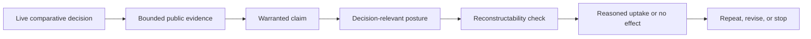

# Provisional Gate 3 — Intervention Selection

## Control

- **Intervention Selection ID:** `SEC-MARKET-G3-001`
- **Version:** `0.1`
- **Lifecycle state:** `accepted — provisional`
- **Gate 3:** `passed — provisional`
- **Execution readiness:** `completed — manual signal method validated once`
- **Governing Intent:** `SEC-MARKET-001` v1.0 in [intent.md](../../../intent.md)
- **Outcome Architecture:** `SEC-MARKET-OA-001` v0.1 in [outcome-architecture.md](outcome-architecture.md)
- **Live Decision Contract:** `SEC-MARKET-DC-001` v0.1 in [decision-contract.md](decision-contract.md) — completed and sealed
- **Execution Specification:** `SEC-MARKET-EX-001` v0.1 in [execution-specification.md](execution-specification.md) — completed
- **Market Signal Episode:** `SEC-MARKET-SIG-001` v0.2 — completed and independently reviewed
- **Plan implementation authorized:** 2026-08-15
- **Authorization evidence:** “Implement the plan as specified.”

## Compressed intervention decision

> C3—turning warranted claims into decision-relevant insight—is the highest-leverage gap. Address it through one manual, prospective, comparative security-leadership decision episode that creates only the thin C1/C2/C4/C5 support needed to test decision relevance and observe reasoned uptake.

## Gap analysis

### C3 — Claims become decision-relevant insight

- **Standing:** highest-leverage bottleneck
- **Gap at selection time:** no authorized contract connected a material market change to a beneficiary, decision horizon, posture, and consequential next action.
- **Current state:** the selected live episode and sealed decision contract now define that bridge for execution specification.
- **Intervention implication:** test C3 directly in a live decision rather than building more upstream collection.

### C2 — Evidence becomes an honest claim

- **Standing:** required thin input to C3
- **Gap:** provenance and transparency boundaries exist, but operational warrant is missing.
- **Intervention implication:** use minimum claim semantics for one episode rather than designing a universal confidence rubric.

### C1 — Relevant change can be observed

- **Standing:** required thin input to C3
- **Gap:** sources are mapped, but no operating observation capability exists.
- **Intervention implication:** collect bounded point-in-time evidence manually; broad source infrastructure is unnecessary.

### C4 — Accessible and reconstructable intelligence

- **Standing:** required support and validation surface
- **Gap:** no intelligence artifact has been reconstructed by a second reader.
- **Intervention implication:** one dated judgment plus a second-reader test is sufficient initially.

### C5 — Learning without erasing history

- **Standing:** required thin support
- **Gap:** append-only principles exist, but no operating learning loop exists.
- **Intervention implication:** preserve a sealed baseline and original judgment, then permit one dated addendum.

### B1 — Reasoned beneficiary uptake

- **Standing:** critical causal bridge, jointly controlled
- **Gap:** no live decision has recorded whether intelligence changed understanding, criteria, timing, posture, or next action.
- **Intervention implication:** record uptake or a specific no-effect result without requiring downstream business outcomes.

C3 is the leverage target, but a C3-only memo would be unsupported narrative. The responsible cut is a C3-led vertical slice with only the C1/C2/C4/C5 needed for one live episode.

## Alternatives considered

### A — Live comparative decision episode

**Selected.**

- One still-influenceable planning decision, one focal cybersecurity domain, and at least one genuine alternative: another domain, the current posture, or deliberate deferral.
- Directly tests C3 and observes B1 while exercising thin C1–C5.
- Highest causal coverage and learning value with low implementation commitment and high reversibility.

### B — Retrospective or hypothetical packet

**Rejected as the primary intervention.**

- Useful for method rehearsal.
- Cannot establish prospective timing or genuine uptake.
- Risks hindsight selection and persuasive reconstruction of a known result.

### C — Public-evidence sufficiency probe

**Retained conditionally inside Approach A.**

- Useful if the live episode selects an evidence-blind domain such as agentic identity or AI governance.
- Primarily tests C1/C2 rather than decision value.
- Must remain timeboxed and must not expand into source infrastructure by default.

### D — Pipeline, confidence rubric, website, autonomous agent, or partner-risk monitor first

**Rejected.**

- Expands upstream plumbing while leaving C3 and B1 untested.
- Risks encoding unvalidated source, score, storage, and delivery assumptions.
- The partner-risk-first build sequence serves a different primary outcome.

## Selected intervention

Run one manual, prospective, comparative decision episode for security leadership, including CSPs.

The selected live episode focuses on **AI data security and governance**. Varonis, Cyera, and Secuvy anchor the current engagement context but do not constrain the market scan, evidence universe, or conclusions. Identity is deferred as the next domain.

### Before research

Seal a decision contract containing:

- named owner and confirmation that the decision is still influenceable;
- event-based pilot review trigger;
- focal cybersecurity domain and at least one genuine alternative;
- current posture and information state;
- available postures and the concrete consequence of each;
- local meaning of “early enough” and the cost of a wrong early call;
- research-freeze rule, research budget, and stop rule;
- observation method for reasoned uptake or no effect; and
- public-core versus private decision-effect-record boundary.

### Bounded judgment

Produce one dated judgment that:

- separates observation from inference;
- identifies underlying source origins and dependence rather than citation count;
- states the material change, scope, coverage gaps, conflicts, strongest alternative, and falsifier;
- keeps evidence integrity, claim warrant, and action readiness distinct;
- recommends a reversible posture: investigate, prepare, prioritize, defer, watch, unchanged, or no-call;
- names the evidence that would reverse the posture; and
- preserves longer-horizon context without treating the infrastructure-to-security lag thesis as established fact.

### After delivery

- Have a second reader reconstruct the judgment from cited evidence.
- Record prior and resulting posture, criteria, timing, next action, and uncertainty.
- Record reasoned uptake or a specific no-effect result.
- Preserve the original and allow one dated addendum rather than rewriting history.
- Decide whether to repeat, modify, or stop before authorizing production infrastructure.

## Anti-proxy safeguards

- Artifact completion, citation volume, source prestige, broad coverage, and reader agreement are not success.
- Seal the baseline before delivering the intelligence to prevent decision laundering.
- Historical cases may rehearse the method but cannot prove prospective utility.
- Repetition of one underlying claim does not constitute independent corroboration.
- Insufficient evidence and no-call are valid results.
- “Watch” cannot become a universal non-decision; each posture must have a distinct consequence.
- Falsifiers and reversal conditions cannot be rewritten after they fire.
- This episode targets leadership-lane learning only. Seller, account-team, client, pipeline, and bookings evidence remain later outcome tests.

## Reused prior work

### Retained as discipline

- Provenance and source attribution
- Point-in-time research freezes and leakage prevention
- Append-only history
- Explicit unavailable states
- No-signal versus negative-signal distinction
- Share-versus-category decomposition
- Source independence and corroboration
- Confounds, alternatives, and falsifiers

### Retained as candidates

- Tempo and posture vocabularies
- Coverage thresholds
- Confidence terminology
- Candidate public source families

These require reconciliation against the live decision contract and are not inherited authority.

### Deferred

- Data contracts, fetchers, scheduling, run health, and automation
- Full confidence rubric
- Website, newsletter, and audience cuts
- Database, cadence, hosting, and backfill
- Paid sources and full-domain coverage

### Not authorized

- Partner-risk-first sequencing
- West/NorCal-first delivery
- Varonis as the governing acceptance test
- T0–T5 as a collapsed evidence, inference, and action score
- The infrastructure-to-security lag thesis treated as established fact

## Decision contract

### Completed and sealed

- **Owner:** project owner acting in a security-leadership/CSP capacity
- **Decision:** differentiate and position AI data security and governance vendor approaches for the next one to four quarters
- **Directional anchors, not constraints:** Varonis, Cyera, and Secuvy
- **Genuine alternative:** retain the current undifferentiated engagement posture
- **Pilot review trigger:** immediately after the bounded judgment and second-reader reconstructability check are complete
- **Research freeze:** timestamp the initial evidence packet when the bounded research pass is sealed; later evidence belongs in a dated addendum
- **Timing boundary:** move as quickly as evidence integrity allows; do not wait for an arbitrary calendar date
- **Baseline:** active partner engagements with no formal comparative market posture
- **Boundary:** one bounded public-evidence pass, reversible actions only, public intelligence core, private decision-effect record

The full contract is authoritative in [decision-contract.md](decision-contract.md).

## Nonblocking unknowns

- Full confidence rubric
- Long-term signal-family priority
- Website, newsletter, and autonomous-agent architecture
- Database, cadence, hosting, and deployment
- Paid-source access, domain breadth, and backfill
- Partner-risk monitoring and confidential overlays
- Regional tuning
- Future beneficiary adoption and business results

## Pilot exit conditions

- The case remained prospective and point-in-time clean.
- Material assertions trace to evidence captured in the sealed research packet.
- Source dependence, scope, alternatives, uncertainty, and confidence dimensions are explicit.
- A second reader can reconstruct the judgment.
- A dated posture is created, retained, changed, or deliberately deferred; no-call remains valid.
- The owner records reasoned uptake or a specific reason the intelligence had no effect.
- The evidence supports a decision to repeat, modify, or stop without first selecting production infrastructure.

## Gate assessment

### Human Acceptance

- **Result:** accepted
- **Direction:** focus first on AI data security and governance; use Varonis, Cyera, and Secuvy as examples of current partners rather than constraints on the market analysis; move into identity afterward
- **Date:** 2026-08-15

### AI Readiness

- **Result:** ready for execution specification
- **Statement:** The gap ranking, alternatives, causal cut, safeguards, and selected intervention follow from the accepted Governing Intent and Outcome Architecture without inventing consequential context.

### Execution result

- **Result:** initial bounded vendor research and the first genuine market-timing episode completed and independently verified
- **Reason:** The live decision contract first produced a source-labeled vendor-validation posture; `SEC-MARKET-SIG-001` then produced a conditional timing judgment and exercised the manual signal runbook without authorizing production infrastructure.

### Gate 3 result

- **Result:** passed — provisional

## Next interface

> Given the selected live comparative decision episode, what is the minimum execution specification needed to produce, deliver, observe, and revise one warranted judgment without adding untested infrastructure?

