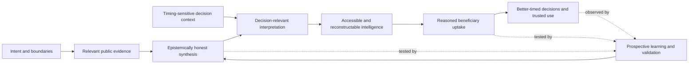

# Provisional Gate 2 — Outcome Architecture

## Control

- **Outcome Architecture ID:** `SEC-MARKET-OA-001`
- **Version:** `0.1`
- **Lifecycle state:** `accepted — provisional`
- **Gate 2:** `passed — provisional`
- **Governing Intent:** `SEC-MARKET-001` v1.0 in [intent.md](../../intent.md)
- **Plan implementation authorized:** 2026-08-15
- **Authorization evidence:** “Implement the plan as specified.”
- **Human Acceptance:** accepted 2026-08-15 — “approved.”
- **AI Readiness:** ready
- **Consolidates:** draft `SEC-MARKET-NC-001` v0.1 in [necessary-conditions.md](necessary-conditions.md)
- **Current validation:** `SEC-MARKET-SIG-001` v0.2 completed and independently reviewed

## Minimum sufficient architecture

> Public national and global evidence must become early, honest, reconstructable insight that security leadership, account teams, and clients can apply to timing-sensitive GTM, account, and technology decisions. Prospective learning must then test and refine the intelligence without requiring future adoption or business results as permission to begin.

## Prerequisite conditions

### P1 — Governing clarity and publication boundary

Purpose, beneficiaries, observable success, public-data boundaries, and non-goals must be sufficiently clear.

- **State:** evidenced and decided
- **Presence:** present in [intent.md](../../intent.md)
- **Causal role:** prevents downstream work from substituting a deliverable, geographic cut, or narrow use case for the governing outcome.

### P2 — Real timing-sensitive decision context

Security leadership, account teams, and clients must face consequential GTM, account, and technology choices across horizons from the present through 24 months.

- **State:** assumed, with direct owner evidence and support from workflow spec §1
- **Presence:** sufficiently present for Gate 2; not independently validated in operation
- **Causal role:** without a decision that can still change, even accurate intelligence cannot create the intended value.

### P3 — Reachable public evidence

Relevant national and global evidence must exist and be observable lawfully and publishably before at least some decisions close.

- **State:** partially evidenced; early utility hypothesized
- **Presence:** candidate sources and access paths are documented in workflow spec §5 and build spec §2.3; operating capability is absent
- **Causal role:** evidence must be both reachable and timely enough to support a forward decision rather than merely explain the past.

### P4 — Epistemic and governance discipline

Provenance, uncertainty, alternatives, confidence, public/confidential separation, and no-forced-call rules must govern the work.

- **State:** decided
- **Presence:** present as policy in [intent.md](../../intent.md) and reinforced by workflow spec §§6 and 10; operational detail is missing
- **Causal role:** makes reliance rational and allows trust to be earned rather than asserted.

## Creation conditions

### C1 — Relevant change can be observed

The initiative must detect material movement across useful signal families and decision horizons while making gaps and unavailable evidence visible.

- **State:** hypothesized
- **Presence:** source families and coverage gaps are mapped, but no operating observation capability exists
- **Causal role:** no interpretation is possible without a sufficiently relevant and timely change to interpret.

The existing vendor, infrastructure, demand-side, analyst, funding, filing, and market-data proposals are evidence of possibilities, not selected mechanisms.

### C2 — Evidence becomes an honest claim

Observations must be evaluated for directness, recency, source incentives, independence, corroboration, confounds, and credible alternatives. Claims must retain provenance and calibrated uncertainty.

- **State:** partly decided at the boundary level and partly hypothesized at the operational level
- **Presence:** partially specified through provenance fields, quality rules, falsifiers, and analytical hygiene; materially missing in practice
- **Causal role:** separates a market signal from noise, repetition, marketing, hindsight, or unsupported certainty.

### C3 — Claims become decision-relevant insight

Interpretation must connect a material change to a beneficiary, decision class, horizon, and appropriate posture: prioritize, prepare, investigate, influence, defer, or watch.

- **State:** required by the accepted outcome
- **Presence:** materially missing; the workflow spec contains candidate tempo concepts, but no authorized decision contract
- **Causal role:** this is the load-bearing bridge from market observation to beneficiary value. Collection, scoring, and reporting alone cannot satisfy it.

### C4 — Intelligence is accessible and reconstructable

Intended beneficiaries must be able to encounter and apply a common intelligence core. Another person must be able to reconstruct what was known, what was inferred, what changed, and why.

- **State:** decided as a success condition; common-core portability assumed
- **Presence:** store and output principles exist on paper; implementation and use are missing
- **Causal role:** inaccessible insight cannot affect decisions, while unreconstructable insight cannot sustain justified trust.

Websites, newsletters, autonomous agents, audience cuts, and storage choices remain possible mechanisms rather than conditions.

### C5 — Learning changes the model without erasing history

New evidence must be able to revise claims, confidence, and assumptions while preserving prior states and explaining deltas.

- **State:** partially evidenced as a design principle
- **Presence:** append-only and changed-recommendation principles are documented; the learning loop is missing
- **Causal role:** allows the intelligence to improve, expose mistakes, and remain accountable as market conditions change.

## Bridge condition

### B1 — Reasoned beneficiary uptake

The beneficiary incorporates the judgment alongside other relevant evidence when considering a live decision. Delivery, readership, or a conversation does not by itself establish uptake; the intelligence must contribute to understanding, evaluation criteria, timing, a next action, or the decision itself.

- **State:** necessary causal bridge, jointly controlled by the initiative and beneficiary
- **Presence:** missing and observable only in later use
- **Causal role:** converts accessible decision intelligence into a genuine opportunity for outcome impact without pretending the initiative controls beneficiary behavior.

## Validation conditions

These are evidence to seek after creation begins. They are not prerequisites for near-term project work.

### V1 — Factual and provenance integrity

Sources, captures, transformations, and claims are traceable and reproducible.

### V2 — Prospective signal utility

Timestamped interpretations sometimes arrive early enough to affect a live decision. Hindsight-only recognition does not count.

### V3 — Analytical validity

Falsifiers, confounds, share-versus-category effects, signal independence, and alternative explanations are tested rather than narrated away.

### V4 — Decision usefulness

Beneficiaries can explain whether an insight changed, accelerated, investigated, or deliberately deferred an appropriate decision.

### V5 — Core portability

Evidence eventually shows where a common core transfers across beneficiary and regional contexts and where tuning is genuinely needed.

## Outcome conditions

The governing outcome is materializing when:

- a GTM or resource decision is changed or accelerated by traceable intelligence;
- an account team uses the intelligence in a meaningful client conversation;
- a client uses it when evaluating technology, timing, or partner choices; and
- reasoning remains reconstructable, uncertainty stays visible, and trust is earned through useful and honest performance.

These conditions recognize success. They are not permission slips to begin work.

## Evidence reconciliation

### Present

- Accepted purpose, beneficiaries, boundaries, assumptions, and observable success in [intent.md](../../intent.md)
- The sharper decision-episode, warranted-judgment, timely-advantage, and reasoned-uptake concepts developed in draft [necessary-conditions.md](necessary-conditions.md)
- Candidate public source landscape and signal families in workflow spec §5 and build spec §2.3
- Coverage gaps and minimum-coverage reasoning in workflow spec §§4.2 and 6.1
- Explicit lag-thesis falsifiers in workflow spec §3
- Provenance, append-only history, reproducibility, and run-health principles in build spec §§3 and 6
- Share-versus-category and cross-signal analytical disciplines in workflow spec §§7.5 and 7.6
- Audience-neutral core principle in workflow spec §8

### Materially missing

- Operating evidence and observed signal history
- An operational claim-quality and confidence model
- Translation from signals to beneficiary decisions and timing
- Access to and use of a common intelligence core
- Prospective validation and beneficiary feedback loops
- An authorized intervention path aligned with the Governing Intent

### Reusable after downstream selection

- Source access research and adapters
- Data contracts, provenance, append-only history, idempotency, and run health
- Coverage rules and explicit unavailable states
- Share-versus-category decomposition, corroboration concepts, and falsifiers
- Confidence and tempo concepts, provided they are operationalized rather than assumed

### Not governing and not carried forward automatically

- Partner-risk-first sequencing from build spec §§1–2
- West/NorCal-first delivery from workflow spec §8.5
- The Varonis backtest as the governing acceptance test
- Any particular website, newsletter, agent, database, schedule, or hosting choice
- The untested infrastructure-to-security lag thesis as if it were established fact

### Traceability issues to resolve during specification reconciliation

- `security-signal-BUILD-SPEC-v1.0.md` is named v1.0 but identifies its contents as v1.1.
- Existing build completion criteria measure a partner-risk mechanism rather than the accepted outcome.
- The T0–T5 evidence-confidence concept and partner-risk alert tiers answer different questions and must not be conflated.
- Draft [necessary-conditions.md](necessary-conditions.md) has been consolidated into this architecture and is retained only as supporting reasoning, not as a competing Gate 2 candidate.

## Present versus missing assessment

The repository has substantial reasoning, source research, analytical safeguards, and proposed data foundations. It does not yet contain implementation, operating data, prospective evidence, or demonstrated beneficiary use.

That absence does not block Gate 2. It defines the gap that downstream intervention selection must address.

## Unknowns

### Blocking for Gate 2

None. The causal conditions and their relationships are sufficiently understood for intelligent gap analysis.

### Provisionally resolved for gap analysis

A first decision lane has been selected below with a beneficiary, decision class, horizon, available postures, and observable decision effect. It is sufficient for gap analysis and must be confirmed or refined before a final intervention is selected.

### Nonblocking

- Which signal family proves most useful
- Detailed confidence rubric
- Exact presentation or delivery format
- Autonomous-agent architecture
- Regional or audience tuning
- Paid-source access
- Full domain breadth and backfill depth
- Partner-risk monitoring
- Confidential overlays
- Future adoption, pipeline, bookings, or business results

## Provisional first decision lane

The first lane for gap analysis and intervention selection is:

- **Beneficiary and owner:** security leadership, including CSPs
- **Decision:** which cybersecurity domain deserves investigation, preparation, prioritization, or deliberate deferral
- **Decision horizon:** the next planning commitment, with primary attention to the coming one to four quarters and longer-horizon context retained where relevant
- **Observable decision effect:** a dated priority or posture is created or changed, with the contributing intelligence and uncertainty recorded

This lane is selected because it directly exercises the Governing Intent, has an accessible decision owner, does not depend on future seller or client adoption, and tests the full signal-to-decision chain without reducing the project to partner risk.

It does not decide which domain, signal source, analytical method, or deliverable will be used.

## Gate assessment

### Human Acceptance

- **Result:** accepted
- **Statement:** “approved.”
- **Accepted by:** project owner
- **Date:** 2026-08-15

### AI Readiness

- **Result:** ready
- **Statement:** The minimum causal spine, condition types, evidence states, present-versus-missing assessment, and stage-relative unknowns are sufficiently clear to support gap analysis and intervention selection without inventing consequential assumptions.
- **Date:** 2026-08-15

### Gate 2 result

- **Result:** passed — provisional
- **Why:** Human Acceptance and AI Readiness are explicit. The architecture is sufficient rather than complete, and missing implementation, adoption, and behavioral proof remain creation, validation, or outcome gaps rather than circular prerequisites.

## Next interface

> Where is the highest-leverage gap in these conditions, and what is the smallest responsible intervention that could create and test it for the provisional first decision lane?

